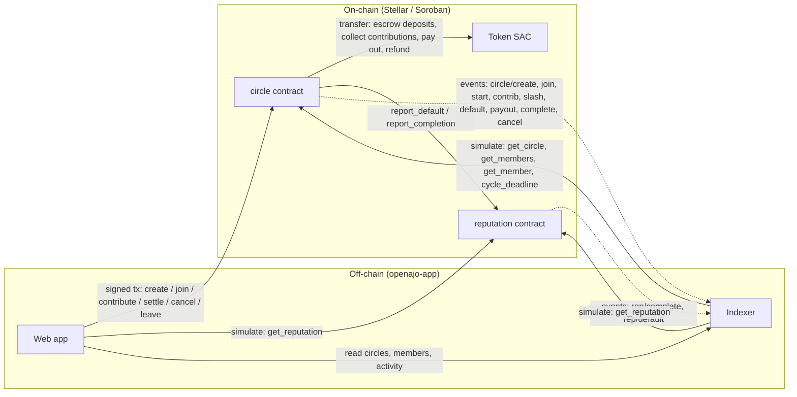

# Architecture & interactions

This page shows how the pieces of OpenAjo fit together: the two on-chain
contracts, the token they move, and the off-chain indexer and web app. Solid
arrows are **calls** (transactions or cross-contract invocations); dashed arrows
are **events**. All on-chain calls and event reads travel through Stellar RPC,
which is omitted for clarity.



## Reading the diagram

- **Web app** submits signed transactions to `circle` (and reads `reputation`
  directly by simulation). It never talks to the indexer for writes.
- **Indexer** is read-only: it folds the contracts' events into a queryable
  store and re-reads the named circles by simulation, so a missed event costs a
  timeline entry, never a wrong balance. See
  [Events](reference/events.md).
- **circle** is the only contract that moves token value and the only contract
  that calls **reputation**, during `settle_cycle` (`report_default` when a
  deposit cannot cover a miss, `report_completion` for each non-defaulted member
  on completion).
- **reputation** is written only by allow-listed reporters; `circle` is added to
  that list at deploy time. See
  [Reputation](design/reputation.md).
- **Token SAC** is the Stellar Asset Contract for the asset the circle runs in
  (native XLM on testnet, or a stablecoin SAC in production). Amounts are
  `i128` raw units with 7 decimals.

## Settle one cycle (call chain)

```mermaid
sequenceDiagram
    participant Caller as Anyone (crank or member)
    participant Circle as circle
    participant Token as Token SAC
    participant Rep as reputation
    participant Idx as Indexer

    Caller->>Circle: settle_cycle(circle_id)
    Circle->>Circle: slash deposits into pot (accounting; tokens already escrowed)
    Circle->>Rep: report_default(circle, member) [if a deposit ran short]
    Circle->>Token: transfer pot to recipient
    Circle->>Token: refund remaining deposits (on completion)
    Circle->>Rep: report_completion(circle, member) [on completion]
    Circle-->>Idx: events circle/slash, default, payout, complete
    Rep-->>Idx: events rep/default, rep/complete
```

## Related

- [The circle lifecycle](design/lifecycle.md)
- [Settlement](design/settlement.md)
- [Events](reference/events.md)
- [Reputation](design/reputation.md)
```