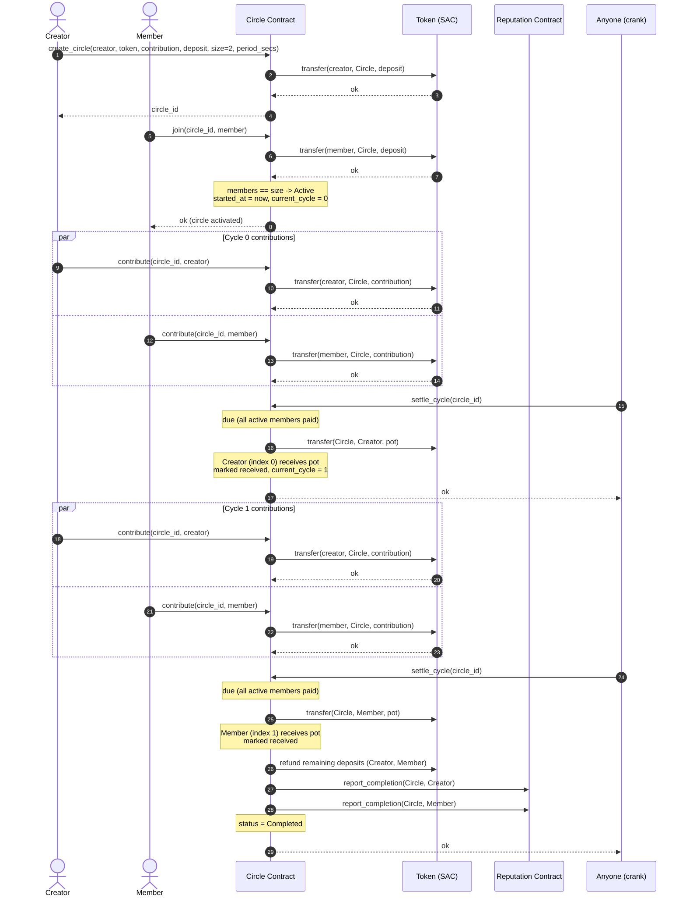
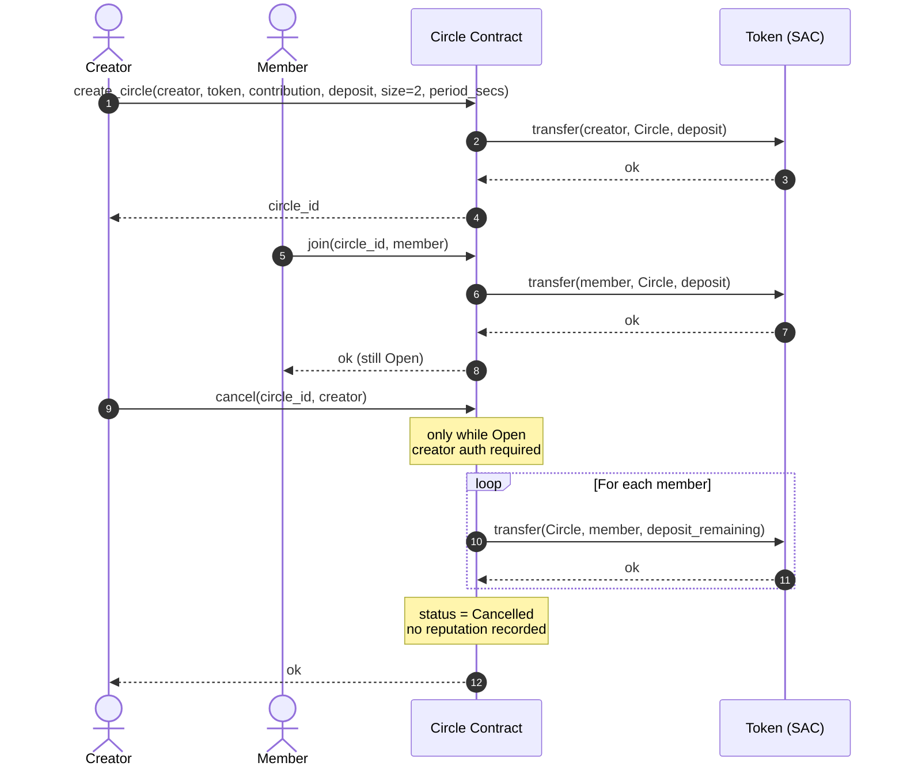

# The circle lifecycle

A circle moves through four states. One `circle` contract instance manages many
circles at once, each identified by a `u32` id assigned at creation.

```
        create_circle
             │
             ▼
        ┌─────────┐   join (until full)     ┌──────────┐
        │  Open   │ ──────────────────────▶ │  Active  │
        └─────────┘   auto-starts at size   └──────────┘
          │   │                                  │
   leave  │   │ cancel                           │ settle_cycle
 (refund) │   │ (refund all)                     │ (repeated)
          ▼   ▼                                  ▼
      back to Open / ┌───────────┐         ┌────────────┐
      removed        │ Cancelled │         │ Completed  │
                     └───────────┘         └────────────┘
```

## Open

`create_circle` makes a circle and puts the creator in as the first member. The
creator posts their deposit in the same transaction, so the escrow starts funded.

While a circle is `Open`:

* Anyone may **`join`**, escrowing the deposit and taking the next slot in join
  order.
* A non-creator member may **`leave`** and get their deposit back in full.
* The creator may **`cancel`**, refunding every member.
* The creator may **not** leave — leaving as the creator would orphan the circle,
  so they must `cancel` instead (`IsCreator`).

**Join order is the payout order.** The member at index 0 receives the pot first,
index 1 second, and so on. This ordering is fixed at join time and never
re-sorted.

## Active

The moment the final member joins and the circle reaches `size`, it activates
automatically inside that same `join` call. `started_at` is set to the current
ledger timestamp, and `current_cycle` begins at 0.

From here the circle only moves forward. There is no leaving and no cancelling an
`Active` circle — funds are committed. The two things that happen are:

* Members **`contribute`** each cycle.
* Anyone **`settle_cycle`s** the circle once the cycle is due.

Each settlement pays one member and advances to the next cycle. See
[Settlement](settlement.md).

## Completed

When a settlement finds that every member who has not defaulted has already
received their payout, the circle completes. In that final settlement the
contract refunds each non-defaulted member's remaining deposit and reports a
completion to the `reputation` contract for each of them.

A completed circle holds no funds. That invariant — a finished circle's token
balance is zero — is asserted directly in the tests.

## Cancelled

A terminal state reachable only from `Open`, via the creator calling `cancel`.
Every deposit is refunded. No reputation is recorded, because nothing was
completed and nobody defaulted — a cancelled circle is a non-event on a member's
record.

## Why `Active` is a one-way door

It is worth being explicit about why you cannot leave or cancel an active circle.
Once the pot has started rotating, some members have received and some have not.
Allowing an exit at that point would let a member who has already been paid walk
away from their remaining contributions — which is exactly the failure mode the
protocol exists to prevent. The deposit and the forward-only lifecycle are two
halves of the same guarantee.

## Sequence diagrams

The diagrams below use a two-member circle (`size = 2`) as the running example.
Deposits and contributions are shown as token transfers between participants and
the circle contract; `require_auth()` calls are implicit on every arrow that
names an acting address.

### Create → join → contribute → settle → complete



### Cancel


